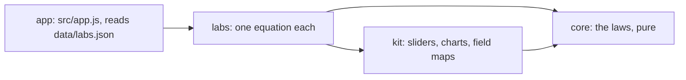

# Electrodynamics Lab
> **Moved.** This lab now lives in [bachelor-lectures-aid-kit](https://github.com/Abdulhamid-Baghdadi/bachelor-lectures-aid-kit) (folder `Electromagnetism`), site: <https://abdulhamid-baghdadi.github.io/bachelor-lectures-aid-kit/Electromagnetism/>. This repository is kept for its links only.

Twenty-eight key equations of electrodynamics and wave propagation to play with in the browser, from Maxwell's equations to transmission lines,
each with its full equation set and its number in the lecture notes of Prechtl (2010), *Vorlesungen über
Elektrodynamik*, TU Wien.

<picture>
  <source media="(prefers-color-scheme: dark)" srcset="docs/gauss-dark.gif">
  
</picture>

## What is in it

| Chapter of the notes | Labs |
|---|---|
| 2 Properties of electromagnetic fields | Gauss's law, no magnetic charge, induction law, Ampère–Maxwell law, conservation of charge, material equations, Poynting vector, Lorentz force |
| 3 Static and stationary fields | point charge and potential, Laplace equation (solved on a grid), electric dipole, charge relaxation, Biot–Savart formula |
| 4 Induction | skin effect |
| 5 Electromagnetic waves | wave speed, plane wave, Hertz dipole, transmission line |
| Wave propagation, after Lasser (2012) | polarisation, plane wave in a lossy medium, reflection and refraction (Fresnel, Brewster), rectangular waveguide, microstrip line, Fresnel zones, link budget, radar equation, fading in space, frequency-selective fading |

The first four rows follow Prechtl (2010); the last follows the TU Wien wave propagation notes, *Wellenausbreitung*,
which treat the engineering side more exactly: complex permittivity, reflection by polarisation, waveguide modes, link
budgets in decibels.

Each lab has a field or chart to move, readouts worked by the physics core, a table of the equations behind it (integral
and local forms, jump conditions, derived steps marked as derived) and a practice question.


## Open it

Published at <https://abdulhamid-baghdadi.github.io/electrodynamics-lab/>. Locally, serve the folder and open
<http://127.0.0.1:8766/>:

```bash
python -m http.server 8766 --bind 127.0.0.1
```

Nothing is sent anywhere; the page keeps only your light or dark choice in the browser.

## How it is built



Plain JavaScript modules, no build step. Layers and their tests: [ARCHITECTURE.md](ARCHITECTURE.md). Tests:
`node --test "tests/unit/*.test.js"`.

## Limits

- A learning aid. Fields are drawn in a plane through 3D sources; grids are coarse (the Laplace lab solves 46 × 30 cells).
- Material values (permittivities, conductivities) are typical room-temperature figures, not from the notes.
- Equation numbers and page ranges refer to the 2010 edition of the notes; no text of the notes is reproduced.
- Practice answers for chapters 2 and 3 are worked by hand; the course's exercises for those chapters are symbolic
  derivations. Chapters 4 and 5 add nine numerical exercises from the course's exercise collection, the Aufgabensammlung of
  TU Wien from 2010, with their answers from its worked solutions.
- The wave propagation labs add eight exercises from that course's exercise part, the Übungsteil of October 2011: six
  with the answers of its worked solutions, and two from the airport radar exercise, for which it prints no number,
  worked by hand. Five more (multipath, exercises 24 and 25) sit in the two fading labs; the partly filled guides (10, 27) fit no lab and are left out.
